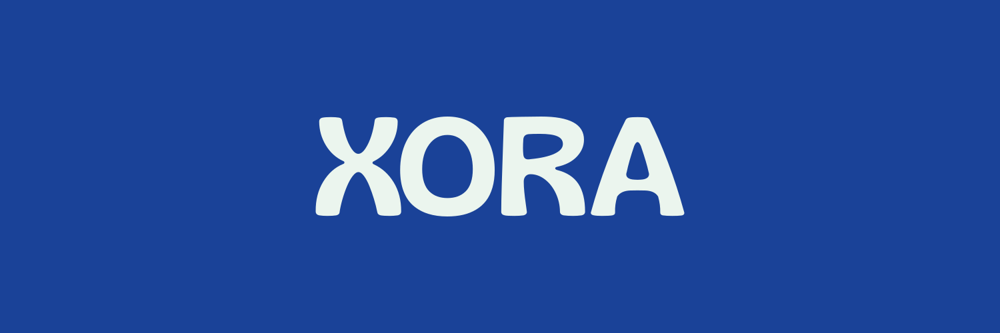

<p align="center">
  <a href="https://nexora.dev">
    
  </a>
</p>

<p align="center">
  <h1 align="center">Xora</h1>
  <p align="center"><strong>Kit de UI y sistema de diseño de Nexora para Flutter</strong></p>
  <p align="center">Componentes, tokens y layouts responsivos para aplicaciones Flutter de Nexora.</p>
</p>

<p align="center">
  
  
  
  
</p>

---

## Tabla de Contenidos

- [Estado del proyecto](#estado-del-proyecto)
- [Acerca de](#acerca-de)
- [Características principales](#características-principales)
- [Tecnologías y Stack](#tecnologías-y-stack)
- [Requisitos previos](#requisitos-previos)
- [Instalación y Configuración](#instalación-y-configuración)
- [Uso](#uso)
- [Estructura del proyecto](#estructura-del-proyecto)
- [Hoja de ruta](#hoja-de-ruta)
- [Contribuir](#contribuir)
- [Seguridad](#seguridad)
- [Licencia](#licencia)

---

## Estado del proyecto

> **Estado actual:** Activo / En desarrollo.

## Acerca de

**Xora** es el sistema de diseño y kit de UI de Nexora para Flutter. Incluye tokens de diseño, componentes reutilizables y layouts responsivos (Nexo, One, Slate) para acelerar el desarrollo de aplicaciones manteniendo la cohesión visual de la organización.

## Características principales

- **Tokens de diseño:** colores, tipografía, espaciado, radios y sombras centralizados.
- **Componentes reutilizables:** botones, campos de texto, tarjetas, insignias, avatares, listas y más.
- **Layouts responsivos:** Nexo (escritorio), One (móvil) y Slate (tableta).
- **Tema claro y oscuro:** `XoraTheme.light()` y `XoraTheme.dark()`.
- **App de ejemplo:** showcase aislado en `example/`.

## Tecnologías y Stack

- Flutter / Dart
- FontAwesome Icons (`XoraIcons`)
- Google Sans (UI) / Gliker (logos)

## Requisitos previos

- Flutter SDK (stable)
- Dart SDK (incluido con Flutter)

## Instalación

```bash
# 1. Clona el repositorio
git clone https://github.com/Nexora-Labs-Co/Xora.git
cd Xora

# 2. Instala dependencias del paquete
flutter pub get

# 3. Instala dependencias del ejemplo
cd example && flutter pub get
```

## Uso

```bash
# Ejecutar el showcase en Chrome
cd example && flutter run -d chrome

# Compilar para web
cd example && flutter build web --no-tree-shake-icons
```

## Estructura del proyecto

```text
./
├── lib/                  # Paquete Xora
│   ├── xora.dart         # Exportación principal
│   └── src/
│       ├── theme/        # Tokens de diseño
│       ├── components/   # Componentes UI
│       ├── layouts/      # Layouts responsivos (Nexo, One, Slate)
│       └── icons/        # Iconos FontAwesome (XoraIcons, XoraIcon)
├── example/              # App de ejemplo aislada
├── assets/               # Recursos del paquete
├── AGENTS.md             # Instrucciones para agentes
├── CONTRIBUTING.md       # Guía de contribución
├── SECURITY.md           # Política de seguridad
├── CHANGELOG.md          # Historial de cambios
└── README.md             # Documentación principal
```

## Hoja de ruta

- [x] Configuración inicial del kit de UI.
- [x] Componentes base y tokens de diseño.
- [x] Layouts responsivos Nexo, One y Slate.
- [ ] Ampliar catálogo de componentes.
- [ ] Documentación de componentes.

## Contribuir

Las contribuciones son bienvenidas. Por favor, lee el archivo [CONTRIBUTING.md](CONTRIBUTING.md) para conocer los detalles sobre nuestro código de conducta y el proceso para enviar pull requests.

## Seguridad

Si descubres alguna vulnerabilidad de seguridad, por favor consulta nuestra política en [SECURITY.md](SECURITY.md) para saber cómo reportarla de forma responsable.

## Licencia

Este proyecto se distribuye bajo los términos de la licencia **PolyForm Noncommercial 1.0.0** (consulta el archivo [LICENSE](LICENSE) para más detalles, SPDX: `PolyForm-Noncommercial-1.0.0`).

> **Nota de marca:** _Nexora_ es titular de todos los derechos de marca. El nombre, la identidad visual y los logotipos de Nexora no pueden ser utilizados ni redistribuidos sin autorización previa por escrito.

---

<p align="center">
  Un proyecto desarrollado por el equipo de <strong>Nexora</strong>.
</p>